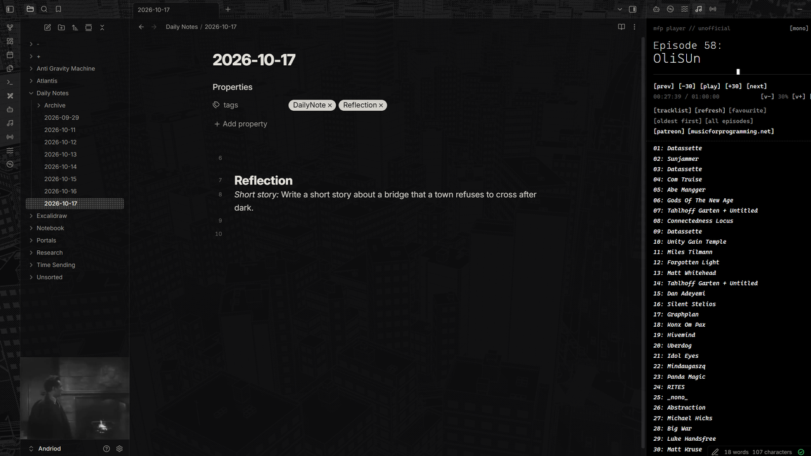
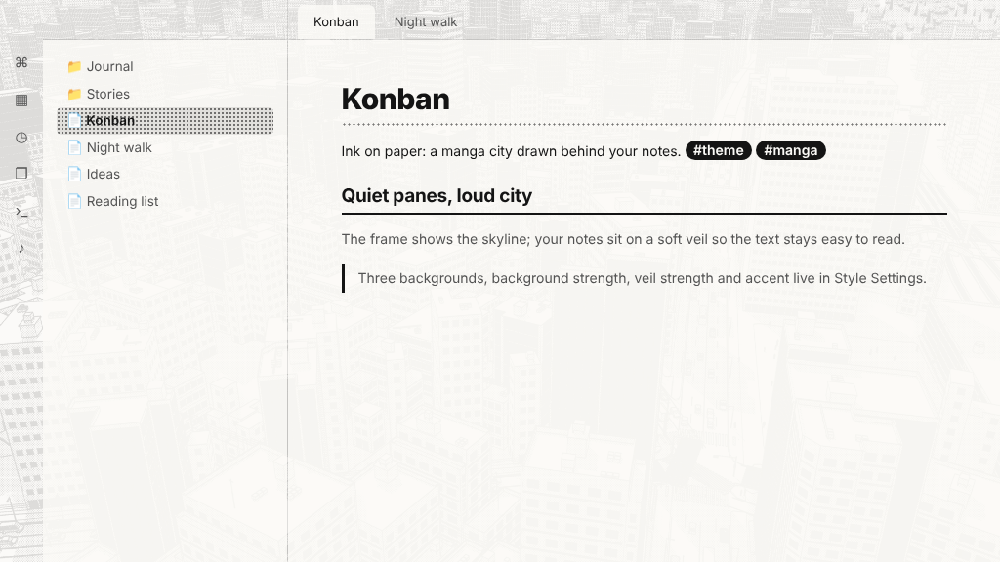

# Konban

A manga-style Obsidian theme: ink on paper, with a screentoned city drawn behind your notes. *Konban* means "tonight" in Japanese.

## The look

- **The frame** (icon strip, top-left corner and top bars) shows the drawing clearly.
- **Your notes and sidebars** sit on a soft paper veil, so the text stays easy to read.
- **Dark mode** is the city at night: the drawing inverted, white ink on black.
- **Light mode** is the printed page: black ink on paper.
- Quiet, flat panels after the Minimal school of design, with manga touches: a dotted screentone underline on the main heading, an inked rule under the second level, ink-pill tags, speech-bubble callouts, and a screentone fill on the active file and selected menu items.

## Settings

With the [Style Settings](https://github.com/mgmeyers/obsidian-style-settings) plugin installed:

- **Background:** City (skyscrapers), Hillside town, or Forest and coast.
- **Background strength:** how strongly the drawing shows everywhere.
- **Veil strength:** how much the notes and sidebars quieten the drawing.
- **Solid note background:** plain paper behind the note you're writing.
- **Accent:** Ink, Hanko red or Tone blue.
- **Panel borders:** thick ink lines between panes, like manga panels.

The drawing is hidden for people who ask their system for reduced transparency. The Settings window always uses plain paper.

## Install

**Settings → Appearance → Themes → Manage**, search for **Konban**, then **Install and use**.

The three drawings are built into the theme file, so it's larger than most themes (about 3.4 MB). Only the drawing you choose is shown.

## Resources used

The background drawings were made with **[World Gacha](https://tools.oyasumi-gamedev.com/worldgacha/)** by MIYADAIKU (Oyasumi Game Dev Club), a free browser tool that generates manga-style towns and landscapes. Follow the creator on X: [@sharp_maker](https://x.com/sharp_maker).

World Gacha's own page says the images you make with it can be used freely, commercially or not, with no credit required. Credit is given here anyway, with thanks. Konban is not made or endorsed by Oyasumi Game Dev Club.

## Support

If you enjoy it, you can [buy me a coffee](https://buymeacoffee.com/ashotis). Questions or problems: open an issue, or email Hello@utilitiz.net.

## License

Theme code: [MIT](LICENSE) © AshOtis. Background drawings: made with World Gacha, see Resources used.
